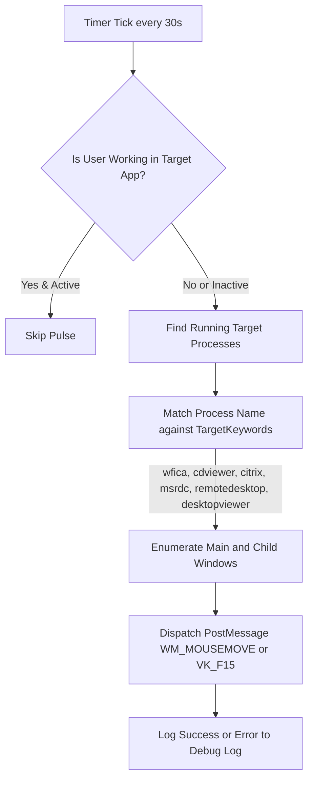

# Plan: Supporting Windows App and Remote Desktop in CaffeineCitrix64

## 1. Objective
Enable CaffeineCitrix64 to keep remote sessions active not only for Citrix (`wfica`, `cdviewer`, `citrix`), but also for Microsoft Windows App and Remote Desktop clients (such as `msrdc`, `remotedesktop`, `desktopviewer`, `DesktopViewer App`).

## 2. Technical Analysis
- **Process Discovery:** CaffeineCitrix64 identifies target applications by checking running process names against `TargetKeywords` defined in `caffeine.properties` (or defaults in [`Main.cs`](Main.cs:1)).
- **Windows App / Remote Desktop Processes:**
  - Microsoft Windows App / Remote Desktop uses process names like `msrdc` (Remote Desktop Client) and title/window names like `Remotedesktop` or `DesktopViewer App` (`cdviewer` or custom wrapper).
- **Configuration Mechanism:**
  - [`caffeine.properties`](caffeine.properties:1) already supports `TargetKeywords=wfica,cdviewer,citrix`.
  - By expanding `TargetKeywords` to include `msrdc`, `remotedesktop`, and `desktopviewer`, CaffeineCitrix64 will automatically target Windows App / Remote Desktop windows and send non-intrusive pulses (`WM_MOUSEMOVE` or `VK_F15`).

## 3. Architecture & Workflow Diagram

## 4. Implementation Steps
1. **Update Default Configuration / Properties:**
   - Extend default `_targetKeywords` in [`Main.cs`](Main.cs:1) and example `caffeine.properties` to include `msrdc`, `remotedesktop`, and `desktopviewer`.
2. **Update Documentation:**
   - Document Windows App / Remote Desktop support in [`README.md`](README.md:1) and [`AGENT.md`](AGENT.md:1).
3. **Build & Verify:**
   - Run `dotnet publish -c Release -r win-x64 --self-contained false` to ensure clean compilation.

## 5. Complexity & Model Recommendation
- **Complexity:** Low (Configuration extension and documentation update).
- **Recommended Model for Implementation:** **Claude 3.5 Sonnet** (or GPT-4o) due to precise C# code modification and documentation alignment.
